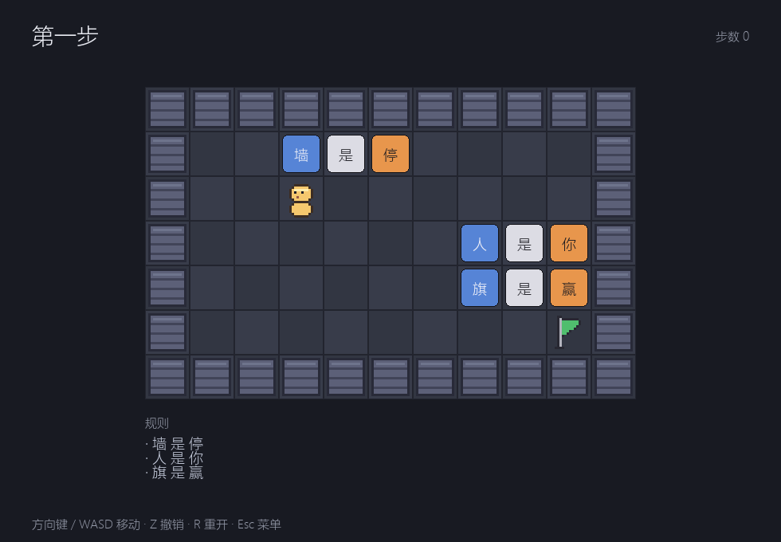
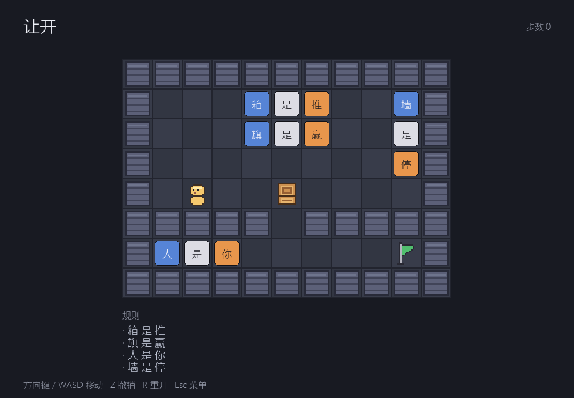

# RuleBox

推得动箱子，也推得动规则。

一款中文词块推箱解谜游戏：墙、箱子、旗子的行为，由场地上可推动的词块决定。
把「墙 是 停」推散，墙就不再挡路；拼出「箱 是 赢」，箱子就成了终点。

> 机制灵感来自《Baba Is You》；代码、关卡、美术均为原创。



## 给接手的开发者 / Agent

- 先读 [`AGENTS.md`](AGENTS.md)（代理操作规范）和 [`docs/HANDOFF.md`](docs/HANDOFF.md)（状态快照、下一步、设计债）
- 原计划见 [`docs/plan.md`](docs/plan.md)，行动清单见 [`docs/checklist.md`](docs/checklist.md)
- 当前基线：82 条测试全过，第 1、2 关可玩

## 环境

- Python 3.10+
- pygame、pytest

## 安装

```powershell
py -3.10 -m venv .venv
.\.venv\Scripts\Activate.ps1
pip install -r requirements.txt
```

## 运行

```powershell
python run.py
python run.py content/levels/02-move-aside.txt
```

| 按键 | 作用 |
| :--- | :--- |
| 方向键 / WASD | 移动 |
| Z | 撤销 |
| R | 重开本关 |
| Esc | 退出 |

没有安装 pygame 时会自动退化为文本输出。

### 键盘没反应？

1. 先点一下游戏窗口。窗口顶部出现「点击窗口后使用键盘」，说明焦点还在终端。
2. 仍然不行时加 `--debug-keys` 运行，终端会打印每一次按键事件：

```powershell
python run.py --debug-keys
```

## 测试

```powershell
pytest
```

## 关卡

| # | 名称 | 教什么 |
| :-: | :--- | :--- |
| 01 | 第一步 | 移动、走到旗子即胜 |
| 02 | 让开 | 推箱子，把挡路的箱子推开 |



## 当前进度

- [x] 仓库初始化
- [x] 关卡 DSL 与加载
- [x] 世界快照与撤销
- [x] 移动、推箱、推词
- [x] 规则解析：`你 / 推 / 停 / 赢`，含 `和`、`不`、变形句的解析
- [x] 胜负判定与过关界面
- [x] 变形结算
- [x] 水/浮、热/融接触结算与失败界面
- [x] 开/关、传送结算
- [ ] 12 关完整内容

## 目录

```text
RuleBox/
├── src/rulebox/
│   ├── core/           # 纯逻辑，不依赖 pygame
│   │   ├── entities.py
│   │   ├── level.py
│   │   ├── world.py
│   │   ├── rules.py
│   │   ├── resolve.py
│   │   ├── movement.py
│   │   └── game.py
│   └── ui/app.py       # Pygame 渲染与输入
├── content/levels/     # 关卡文本
├── tests/              # pytest
├── run.py              # 启动器
└── requirements.txt
```
