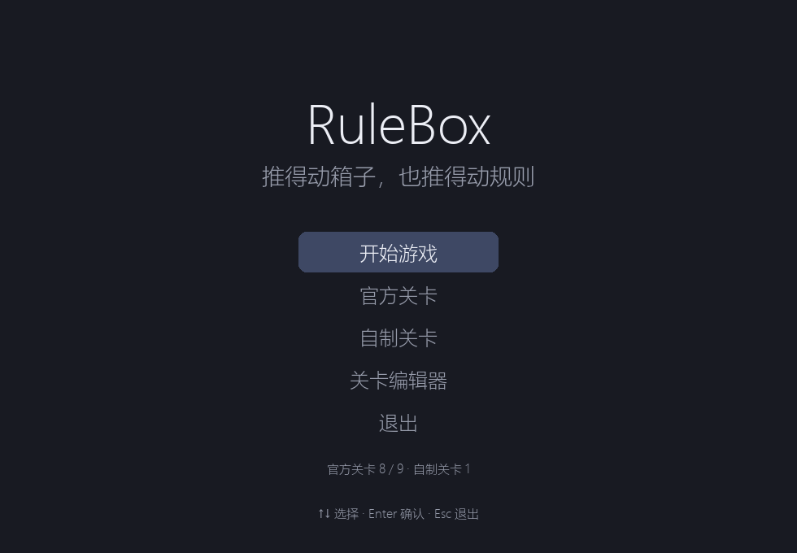
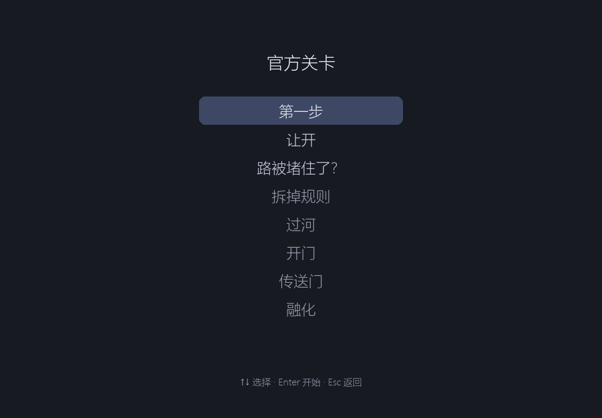
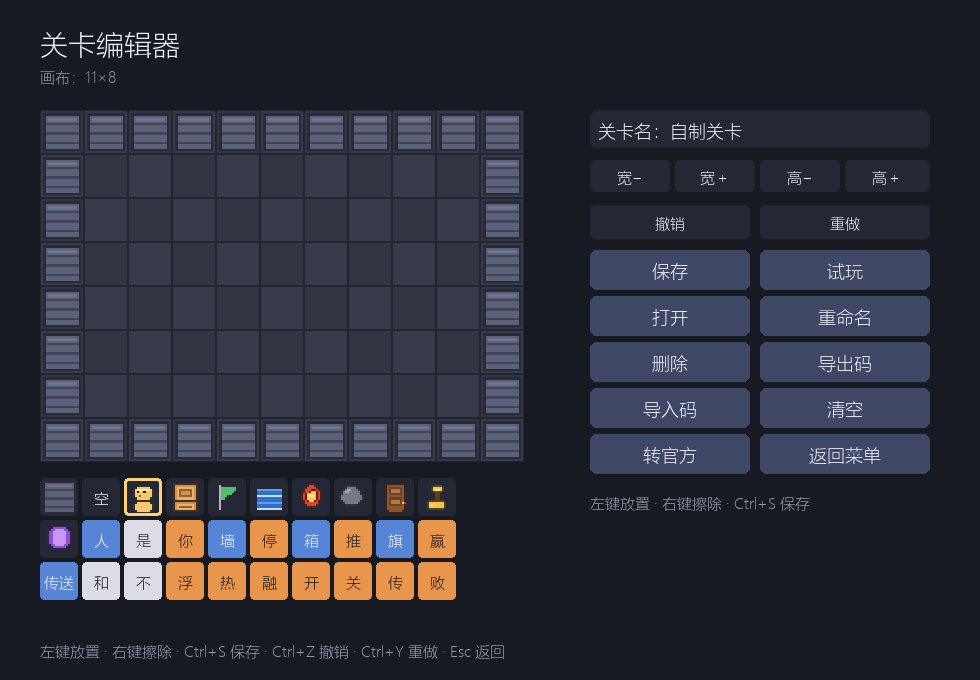
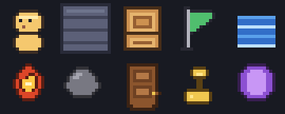
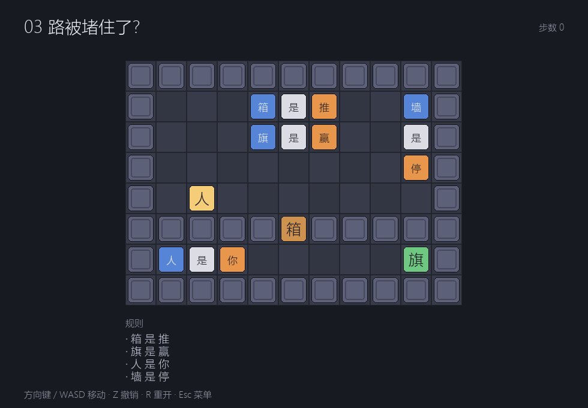

# RuleBox

推得动箱子，也推得动规则。

一款中文词块推箱解谜游戏：墙、箱子、旗子的行为，由场地上可推动的词块决定。
把「墙 是 停」推散，墙就不再挡路；拼出「箱 是 赢」，箱子就成了终点。

> 机制灵感来自《Baba Is You》；代码、关卡、美术均为原创。










## 给接手的开发者 / Agent

- 先读 [`AGENTS.md`](AGENTS.md)（代理操作规范）和 [`docs/HANDOFF.md`](docs/HANDOFF.md)（状态快照、下一步、设计债）
- 全部机制（结算顺序、规则语法、属性表、边界）见 [`docs/MECHANICS.md`](docs/MECHANICS.md)
- 原计划见 [`docs/plan.md`](docs/plan.md)，行动清单见 [`docs/checklist.md`](docs/checklist.md)
- 当前基线：107 条测试全过，第 1–3 关可玩，关卡编辑器可用

## 环境

- Python 3.10+
- pygame、pytest

## 安装

```powershell
py -3.10 -m venv .venv
.\.venv\Scripts\Activate.ps1
pip install -r requirements.txt
```

## 运行

```powershell
python run.py                                  # 开始菜单
python run.py --editor                         # 直接打开关卡编辑器
python run.py content/levels/02-move-aside.txt # 直接进某一关
```

| 场景 | 按键 | 作用 |
| :--- | :--- | :--- |
| 菜单 | ↑↓ / W S | 选择 |
| 菜单 | Enter / Space | 确认 |
| 选关 | ↑↓ / Enter | 选择并开始 |
| 游戏 | 方向键 / WASD | 移动 |
| 游戏 | Z | 撤销 |
| 游戏 | R | 重开本关 |
| 游戏 | N / Enter | 过关后下一关 |
| 游戏 | Esc | 返回菜单 |
| 编辑器 | 左键 / 右键 | 放置 / 擦除 |
| 编辑器 | Ctrl+S / Ctrl+E / Ctrl+I | 保存 / 导出分享码 / 导入分享码 |

通关记录保存在 `progress.json`（已 gitignore），菜单和选关会显示完成状态。

## 关卡编辑器

菜单 → **关卡编辑器**。官方关卡与自制关卡分开存放：

- 官方关卡：`content/levels/*.txt`（仓库内）；
- 自制关卡：`custom_levels/*.txt`（gitignore），从菜单「自制关卡」进入。

编辑器能力：

1. **可调画布**：`宽− / 宽＋ / 高− / 高＋`，范围 5×5 到 20×20；
2. 左键画、右键擦，底部调色板选物件或词块；
3. **试玩**：不落盘，直接进游戏；`Esc` 回编辑器；
4. **保存**：写入 `custom_levels/`，回到菜单「自制关卡」即可看到；
5. **打开**：从已保存的自制关卡中选一个继续编辑；
6. **重命名 / 删除**：作用于当前打开或保存过的自制关卡；
7. **导出码 / 导入码**：分享码写入 `exports/` 并尝试复制到剪贴板，导入时校验后落到 `custom_levels/`。

自定义关卡、导出目录都在 `.gitignore` 里，不会污染仓库。

## 美术

物件使用 **16×16 像素精灵**，位于 `assets/sprites/`：

- 人、墙、箱、旗、水、火、石、门、钥、传送门共 10 个；
- Pygame 用最近邻缩放，保持像素边缘；
- 编辑器调色板和棋盘共用同一套素材；
- 缺图时自动回退到原来的色块 + 文字。

素材由 [`tools/generate_sprites.py`](tools/generate_sprites.py) 生成（需要 Pillow；**运行时不需要**）。

没有安装 pygame 时会自动退化为文本输出。

### 键盘没反应？

1. 先点一下游戏窗口。窗口顶部出现「点击窗口后使用键盘」，说明焦点还在终端。
2. 仍然不行时加 `--debug-keys` 运行，终端会打印每一次按键事件：

```powershell
python run.py --debug-keys
```

## 测试

```powershell
pytest
```

## 关卡

| # | 名称 | 教什么 |
| :-: | :--- | :--- |
| 01 | 第一步 | 移动、走到旗子即胜；横排「墙 是 停」 |
| 02 | 让开 | 推箱子；竖排「墙 / 是 / 停」演示竖向规则 |
| 03 | 路被堵住了？ | 第 2 关地图，箱子下移一格堵住缺口 |




## 当前进度

- [x] 仓库初始化
- [x] 关卡 DSL 与加载
- [x] 世界快照与撤销
- [x] 移动、推箱、推词
- [x] 规则解析：`你 / 推 / 停 / 赢`，含 `和`、`不`、变形句的解析
- [x] 胜负判定与过关界面
- [x] 变形结算
- [x] 水/浮、热/融接触结算与失败界面
- [x] 开/关、传送结算
- [x] 相邻规则句（横排 / 竖排）解析
- [x] 每关「墙 是 停」阻挡
- [x] 开始菜单、选关、通关进度与下一关
- [x] 第 3 关《路被堵住了？》（第 2 关地图，箱子下移一格）
- [x] 关卡编辑器、分享码导入导出
- [x] 官方/自制关卡分离、可调画布、编辑器内试玩、重命名与删除
- [ ] 12 关完整内容

## 目录

```text
RuleBox/
├── src/rulebox/
│   ├── core/           # 纯逻辑，不依赖 pygame
│   │   ├── entities.py
│   │   ├── level.py
│   │   ├── world.py
│   │   ├── rules.py
│   │   ├── resolve.py
│   │   ├── movement.py
│   │   ├── game.py
│   │   ├── catalog.py
│   │   └── level_builder.py
│   └── ui/
│       ├── app.py      # 菜单、选关、渲染与输入
│       └── editor.py   # 关卡编辑器
├── content/levels/     # 官方关卡文本
├── custom_levels/      # 自制关卡（gitignore）
├── assets/sprites/     # 16×16 像素精灵
├── tools/              # 素材生成、Qoder 子 agent 封装
├── tests/              # pytest
├── run.py              # 启动器
└── requirements.txt
```
